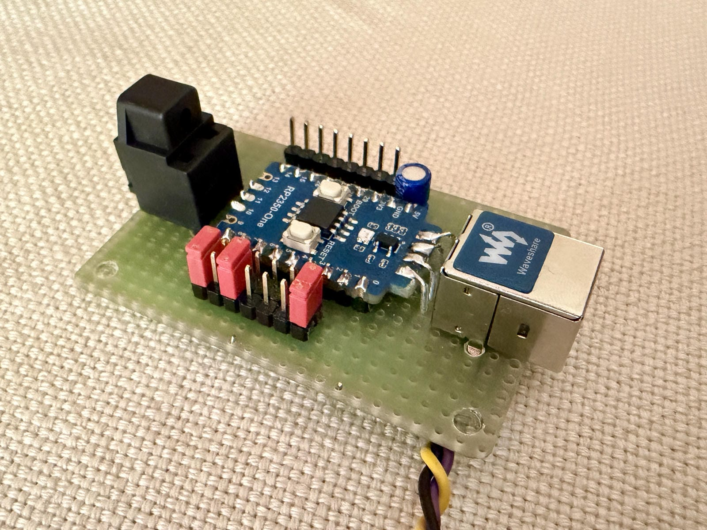

# PicoI2S



USB to I2S audio interface firmware for the RP2350 (Raspberry Pi Pico 2
and clones) that feeds a DAC:

- **USB audio**: USB Audio Class 2.0, asynchronous, the
  Pico is the clock master: no external clock, no resampling. A jumper
  switches to USB Audio Class 1.0 for hosts without UAC2 (TVs, older
  Windows; see [UAC1 mode](#uac1-mode)).
- **S/PDIF input** (coax or Toslink) that plays when USB is idle.
- **Modern DACs**: I2S, left- and right-justified, with a 256 Fs MCLK for
  DACs that need one.
- **Classic multibit DACs**: dual-line 16 / 18 / 20 / 24 bit (PCM56,
  AD1865 / AD1860, AD1862 / PCM63 / PCM1702, PCM1704) and TDA1541A
  simultaneous mode with a DEM clock.
- **On-chip digital filters** for the multibit formats: sharp, slow and
  minimum-phase oversampling (8x at 44.1 / 48 kHz), NOS, and NOS with
  sin(x)/x compensation.
- **S/PDIF output** (Toslink) with the same samples, unfiltered.
- **Host volume control** applied on the device, bit-exact at 0 dB.
- **Set by jumpers**: USB mode, DAC format and filter.

The USB stack is [TinyUSB](https://github.com/hathach/tinyusb) 0.21.0,
included as the `lib/tinyusb` submodule at its release tag; the copy
bundled with the Pico SDK is not used.

## Quick start

Ready-made firmware is attached to each
[release](https://github.com/dpandov/PicoI2S/releases):
`PicoI2S-<version>-rp2350-one.uf2` for the Waveshare RP2350-One,
`PicoI2S-<version>-pico2.uf2` for the Raspberry Pi Pico 2, both the
default build (the [build options](#building) need a build from source).
With one of those, skip to step 4. To build it yourself:

1. Install [VS Code](https://code.visualstudio.com/) with the
   [Raspberry Pi Pico extension](https://marketplace.visualstudio.com/items?itemName=raspberry-pi.raspberry-pi-pico);
   it brings the SDK, compiler, CMake and picotool.
2. Clone with the TinyUSB submodule:
   `git clone --recursive https://github.com/dpandov/PicoI2S.git`
3. Open the folder in VS Code, run "Import Project" from the Pico
   extension (board: Pico 2), then "Compile Project". The firmware is
   `build/PicoI2S.uf2`. For a Raspberry Pi Pico 2 instead of the
   RP2350-One, see [Building](#building).
4. Hold BOOT, plug the board into USB and copy `PicoI2S.uf2` to the drive
   that appears.
5. Wire the DAC: DATA GP14, BCLK GP26, LRCK GP27, MCLK GP28 (if the DAC
   needs one), GND. For S/PDIF, a Toslink transmitter on GP12 (see
   [Hardware](#hardware)).
6. Plug in and play: the host lists "Digital Audio Interface (Pico USB to
   I2S)". With no jumpers fitted it runs as UAC2 with an I2S output and
   no filter; the jumpers select the [DAC format](#i2s-output), the
   [filter](#filters) and [UAC1 mode](#mode-jumper).

## Supported formats

| Mode | Sample rates | Bit depths | Channels |
|---|---|---|---|
| UAC2 (default) | 32, 44.1, 48, 88.2, 96 kHz | 16, 24 | 2 (stereo) |
| UAC1 (GP5 to GND) | 32, 44.1, 48 kHz | 16 | 2 (stereo) |
| S/PDIF input | 32, 44.1, 48, 88.2, 96 kHz | up to 24 | 2 (stereo) |

## Hardware

Minimum build: a Waveshare RP2350-One (or a Raspberry Pi Pico 2, see
below) and a Toslink transmitter. The reference part is the
Cliff FCR684205T (OTJ-5 optical transmitter jack), a 3-pin through-hole
module on 2.54 mm pitch that fits a breadboard.

FCR684205T key figures from the datasheet: Vcc 2.7 to 5.5 V, VIH 2.0 V min,
16 Mbps max NRZ, 5 mA typical. Our highest cell rate is 12.288 MHz at
96 kHz, inside the rated speed.

| FCR684205T pin | Function | RP2350-One pin | Pico 2 pin |
|---|---|---|---|
| 1 | GND | GND | 33 (GND) |
| 2 | Vcc | 3V3 | 36 (3V3 OUT) |
| 3 | Vin | GP12 | 34 (GP28) |

The data pin is `SPDIF_PIN` in `src/board_config.h`.

Run the module from 3V3, not VBUS. Its input is rated to Vcc + 0.5 V and the
board drives 3.3 V logic, so a 3.3 V supply keeps everything in one domain.
Fit a 0.1 uF capacitor between Vcc and GND within 7 mm of the module leads,
as the datasheet requires. The module is ESD sensitive.

On the RP2350-One GP12 is the last pin of the GP0..GP13 row, on the short
side of the board; GND and 3V3 are the second and third pin of the other
row. On the Pico 2 the three are close together near the USB end of the
board: GND on pin 33, GP28 on 34, 3V3 OUT on 36.

On the FCR684205T, pin 1 is the pin nearest the mounting peg side when the
jack opening faces you; check the datasheet drawing in case of doubt.

### Mode jumper

With every jumper open (no jumpers fitted) PicoI2S runs as UAC2 with an
I2S output and no digital filter.

GP5 selects the USB audio class. It is read once at power-up with the
internal pull-up enabled; changing it later has no effect until the next
power-up or reset.

| GP5 | Mode | RP2350-One | Pico 2 |
|---|---|---|---|
| Open | UAC2 (default) | nothing fitted | nothing fitted |
| Jumper to GND | UAC1 | GP5 (sixth pin of the GP0..GP13 row) to GND (top of the other row) | pin 7 (GP5) to pin 8 (GND) |

On the Pico 2 GND is right next to GP5, so a single 2.54 mm jumper (or a
switch) does it.

### I2S output

Besides S/PDIF, PicoI2S drives an I2S DAC (or, in the dual-line modes, a
pair of classic multibit DACs) with the same samples at the same time. The
I2S state machine sits on the same PIO block as the S/PDIF one, is started
in the same write and consumes one frame per the same number of
system-clock cycles, so the two outputs stay sample-aligned and follow the
UAC1 clock trim together. In the I2S, left- and right-justified formats
a 256 Fs MCLK comes out on a fifth pin for DACs that need one (PCM179x,
AK439x, CS43xx types); DACs with their own PLL (PCM5102, ES9023) ignore
it. Clocks and data are low while nothing plays (the outputs stop 3 s
after the audio), unless the firmware is built to keep the clocks running
(see [Building](#building)).

| Signal | RP2350-One | Pico 2 | Note |
|---|---|---|---|
| DATA (DL in the dual-line modes) | GP14 | GP16 (pin 21) | |
| DR | GP15 | GP17 (pin 22) | dual-line modes only |
| BCLK | GP26 | GP18 (pin 24) | |
| LRCK (LATCH in the dual-line modes) | GP27 | GP19 (pin 25) | |
| MCLK / DEM | GP28 | GP20 (pin 26) | 256 Fs MCLK in the I2S / LJ / RJ formats; DEM clock in the TDA1541A format; low in the dual-line formats |
| GND | top of the same row | pins 23, 28 | |

On the RP2350-One the five signals sit in the row that starts with 5V, GND
and 3V3, in this order along the board: GP28, GP27, GP26, GP15, GP14.

The format is set by three jumpers on GPIO 6, 7 and 8 (Pico 2: pins 9,
10, 11, GND on pins 8 and 13), read once at power-up like the mode jumper;
a grounded pin is a 1:

| GP8 | GP7 | GP6 | Format |
|---|---|---|---|
| open | open | open | I2S (Philips), 32-bit slots, MSB one BCLK after the LRCK edge |
| open | open | gnd | Left-justified |
| open | gnd | open | Right-justified, 16-bit (24-bit with the `PICOI2S_RJ24` build option) |
| open | gnd | gnd | TDA1541A simultaneous mode, 16-bit |
| gnd | open | open | Dual-line, 16-bit (PCM56) |
| gnd | open | gnd | Dual-line, 18-bit (AD1865, AD1860 / AD1861) |
| gnd | gnd | open | Dual-line, 20-bit (AD1862, PCM63, PCM1702) |
| gnd | gnd | gnd | Dual-line, 24-bit (PCM1704) |

The fifth pin carries MCLK in the I2S, left- and right-justified formats
and the DEM clock in the TDA1541A format; in the dual-line formats it
stays low. The right-justified word length is fixed per build: 16 bits
by default (PT8211-type DACs and the classic Japanese format), 24 bits
when built with `-DPICOI2S_RJ24=ON`.

Three more jumpers, GPIO 2, 3 and 4 (Pico 2: pins 4, 5, 6, GND on pins 3
and 8), select the filter of the dual-line formats (see
[Filters](#filters)), read the same way:

| GP2 | GP3 | GP4 | Dual-line filter |
|---|---|---|---|
| open | open | open | NOS: no filter, the samples as received, at the sample rate (default) |
| open | open | gnd | Sharp, linear phase, oversampled |
| open | gnd | open | Slow roll-off, linear phase, oversampled |
| open | gnd | gnd | NOS with sin(x)/x compensation, at the sample rate |
| gnd | open | open | Minimum phase (the slow magnitude), oversampled |

The remaining codes (GP2 grounded together with GP3 or GP4) are reserved
and select the sharp filter. I2S, left- and right-justified are never
filtered: they always run at the sample rate (64 BCLK per frame, two
32-bit slots, LRCK = Fs), whatever the filter jumpers say, with MCLK =
256 Fs (11.29 / 12.29 MHz at 44.1 / 48 kHz, 8.19 MHz at 32 kHz, 22.57 /
24.57 MHz at 88.2 / 96 kHz; DACs that need a double-speed setting at
88.2 / 96 kHz must be set up for it). MCLK is a 50 % square wave from a
third PIO state machine that restarts its pattern on every BCLK edge, so
it stays locked to BCLK and LRCK under the clock trim too, rising a fixed
20 ns after each BCLK edge. It needs a system clock whose S/PDIF divider
is a multiple of 4, so these formats run the same clocks as UAC1 mode
(147.43 / 135.43 MHz, -186 / -344 ppm) in UAC2 mode too; the host follows
the feedback, so only the absolute pitch carries that error (at most
0.6 cent).

On the RP2350-One all seven jumper pins, GP2 to GP8, are in the GP0..GP13
row, on the side opposite the I2S pins (GP2 is its third pin, GP8 its
ninth). That row has no GND: use the GND at the top of the other row or
the pad on the underside.

#### Dual-line modes

Left and right data on their own pins, MSB first, right-justified to the
DAC's word length, common BCLK, and a LATCH pulse on the LRCK pin, timed
per the datasheets. The word length is the DAC's; PicoI2S sends the top
bits of its samples (truncated, no dither; the volume control is applied
before). Tie the DAC's left and right latch inputs together where it has
two (AD1865 LL and LR).

- Dual-line 16 / 18 / 20 / 24 (two's complement; PCM56, AD1865, AD1860 /
  AD1861, AD1862, PCM63, PCM1702, PCM1704): the LSB sits in the last
  BCLK slot of the frame; LATCH rises three BCLK periods before the end
  of the frame (only its falling edge matters, and three periods are more
  than any of these DACs asks for) and falls shortly after the BCLK
  falling edge that starts the next frame, one PIO cycle into its low
  half, before the rising edge that clocks the next MSB, so the LSB is
  the last bit in before the latch. Leading slots carry
  zeros (the AD1865 keeps the last 18 bits before LATCH; the PCM63 /
  PCM1702 / PCM1704 accept leading bits). The word length must match the
  DAC exactly: a DAC keeps the last bits it shifted in, so a longer word
  loses its top bits (an AD1865 in dual-line 20 plays 12 dB too loud and
  wraps around above -12 dBFS). From the LSB's clock edge to the falling
  LATCH edge there are at least 78 ns at every rate and in both modes
  (the AD1860 asks for 60 ns, the AD1865 for 40), and from the falling
  edge to the next rising BCLK edge at least 26 ns (15 ns asked).
- TDA1541A in simultaneous mode (offset binary, no clock edge allowed
  while LE is high): 16 data slots per frame, the LSB in the last one; the
  LE pulse fills the BCLK-low half of the first slot of the next frame, so
  it rises with the falling edge after the LSB and falls with the rising
  edge that clocks the next MSB. BCLK stays at or below 6.144 MHz,
  within the chip's 6.4 MHz limit.
- DEM clock (TDA1541A format only): a 50 % square wave at the oversampled
  word rate with every filter, NOS included: 256 / 352.8 / 384 kHz at
  32 / 44.1 / 48 kHz and 352.8 / 384 kHz at 88.2 / 96 kHz. With NOS and
  the sinc compensation, which run at the sample rate, that is BCLK / 2
  (BCLK / 4 at 88.2 / 96 kHz). It is phase-locked to LATCH: a third PIO
  state machine on the same block runs at the system clock and counts
  BCLK edges read back from the pin, so every edge follows BCLK by a
  fixed 4 system clocks, trim or not. It is meant for the
  TDA1541A's DEM oscillator pin (pin 16), in place of the capacitor. The
  pin is low in every other format.

#### Filters

The dual-line formats go through the filter selected by the jumpers
before they leave; every filter but NOS runs on core 1. The oversampling
filters interpolate
by 8 at 32 / 44.1 / 48 kHz and by 4 at 88.2 / 96 kHz, so the DAC runs at
256 / 352.8 / 384 kHz and its images move far outside the audio band,
where a simple analogue filter removes them. Fs is the sample rate:

| Filter | Response | Group delay (input samples) |
|---|---|---|
| Sharp | Linear phase. 8x: flat to 0.4535 Fs (20.0 kHz at 44.1 kHz, 21.8 kHz at 48 kHz), ripple below 0.0002 dB, 100 dB down from 0.5465 Fs. 4x: flat to 0.35 Fs (33.6 kHz at 96 kHz), 100 dB down from 0.65 Fs | 36 (8x), 13 (4x) |
| Slow | Linear phase. Flat to 0.25 Fs, -2.8 dB at 0.4535 Fs (20 kHz at 44.1 kHz), -3 dB near 0.46 Fs, 100 dB down from 0.75 Fs. Between Fs/2 and 0.75 Fs part of the first image gets through, by design; all other images are at least 100 dB down | 13 (8x), 8 (4x) |
| Minimum phase | The slow filter's magnitude exactly, with minimum phase: no pre-ringing | about 9 (8x), 4 (4x) |
| NOS | None: the samples as received, at the sample rate | 0 |
| Sinc compensation | At the sample rate: a short linear-phase FIR that, together with the DAC's zero-order hold, is flat at -4.0 dB (+-0.03 dB) up to 0.4535 Fs. The 4 dB of headroom keep its boost of up to +3.9 dB near Fs/2 from clipping. The images stay, as with NOS | 7 |

The filters use Q30 coefficients (`tools/i2s_filter_design.py`, which
also checks the figures above) and 64-bit accumulation. Intersample peaks
above full scale saturate, then the word is truncated to the DAC's length
(no dither). On top of the group delay the filtered output lags the
S/PDIF one by one 96-frame block; S/PDIF itself is never filtered or
delayed and carries the samples unchanged at the sample rate. NOS runs
without core 1 and adds no delay.

`tools/i2s_filter_plot.py` plots them: frequency, impulse and step
response at any sample rate (see [tools/README.md](tools/README.md)).

BCLK is the number of slots per frame times the output word rate. Slots
per frame: 16 for dual-line 16 and the TDA1541A; for the other dual-line formats the
smallest count at or above the word length that divides the clock cycles
per frame (18 to 25); 64 for I2S / LJ / RJ. In UAC2 mode, with an oversampling
filter:

| Format | 32 kHz | 44.1 kHz | 48 kHz | 88.2 kHz | 96 kHz |
|---|---|---|---|---|---|
| Output word rate (dual-line, oversampled) | 256 kHz | 352.8 kHz | 384 kHz | 352.8 kHz | 384 kHz |
| Dual-line 16 and TDA1541A (16 slots) | 4.096 MHz | 5.645 MHz | 6.144 MHz | 5.645 MHz | 6.144 MHz |
| Dual-line 18 | 5.12 MHz (20) | 6.35 MHz (18) | 7.68 MHz (20) | 6.35 MHz (18) | 9.216 MHz (24) |
| Dual-line 20 | 5.12 MHz (20) | 8.467 MHz (24) | 7.68 MHz (20) | 8.467 MHz (24) | 9.216 MHz (24) |
| Dual-line 24 | 6.4 MHz (25) | 8.467 MHz (24) | 9.6 MHz (25) | 8.467 MHz (24) | 9.216 MHz (24) |
| I2S / LJ / RJ (64 slots) | 2.048 MHz | 2.822 MHz | 3.072 MHz | 5.645 MHz | 6.144 MHz |

The slot counts in parentheses follow from the system clock, so they
differ in UAC1 mode: at 32 kHz dual-line 18 uses 18 slots (4.608 MHz),
dual-line 20 and 24 use 24 (6.144 MHz); at every other rate all three
use 24 (8.467 MHz in the 44.1 kHz family, 9.216 MHz in the 48 kHz one). With NOS and the sinc
compensation the slot counts stay and the output word rate is the sample
rate, so BCLK is 8 or 4 times lower (dual-line 16 and TDA1541A: 16 x Fs).

Limitations: the filters and the DEM clock exist for the dual-line formats
only, MCLK for the direct formats only. In UAC1 mode and with the S/PDIF
input the clock trim that follows the source's rate is a fractional PIO
divider, switched between the two adjacent steps by hardware with a
fixed 25 us period (no CPU work): the I2S clocks, MCLK, the DEM clock and
the dual-line LATCH carry a phase error of a few ns peak to peak (about
4 ns at 44.1 / 48 kHz, 8 ns at 88.2 / 96 kHz) at 40 kHz, above the audio
band, plus the fractional divider's own single-cycle stretches (about
7 ns). Asynchronous DACs (ESS type) do not care; a synchronous DAC sees
low-level jitter. UAC2 USB playback has none of it. The 44.1 and 48 kHz
settings of the dual-line formats run the chip at 152.4 / 153.6 MHz,
1.6 / 2.4 % above its 150 MHz rating, to give the filters their cycles
without a larger clock error (see [Clocks and accuracy](#clocks-and-accuracy)).

### Raspberry Pi Pico 2

The firmware also builds for the Raspberry Pi Pico 2 with
`-DPICOI2S_BOARD=pico2` (same RP2350A, 4 MB flash and 12 MHz crystal;
`PICO_BOARD` stays `pico2` for both boards). There S/PDIF is on GPIO 28
(pin 34), chosen because GND (pin 33) and 3V3 OUT (pin 36) sit next to it
at the top of the board, the mode jumper GP5 (pin 7) has GND next to it on
pin 8, and the status LED is the onboard LED on GPIO 25; the I2S pins and the
format and filter jumpers (pins 9 to 11 and 4 to 6) are in the tables
above.

### S/PDIF input

An external S/PDIF source (a CD transport, a streamer) can feed the
PicoI2S through a coax or a Toslink input. It plays whenever USB is not
available, through the selected filter to the I2S / dual-line pins, and
is re-transmitted unchanged on the S/PDIF output.

| Input | RP2350-One | Pico 2 |
|---|---|---|
| Coax (priority) | GP10 | pin 31 (GP26) |
| Toslink | GP11 | pin 32 (GP27) |
| GND | GND | pin 33 |

Toslink: a 3.3 V receiver module, output straight to the pin. Coax: 75 ohm
termination, a coupling capacitor and a self-biased inverter or
comparator that turns the 0.5 V signal into 3.3 V logic. Both inputs have
pull-downs, so an unconnected input reads as no signal. If both carry a
signal, coax plays; a coax signal that appears takes over from Toslink.

- Rates: 32, 44.1 and 48 kHz, also 88.2 and 96 kHz; 176.4 / 192 kHz are
  not decoded. Lock takes about 20 ms.
- USB has priority. USB counts as not available after 3 s without an
  audible sample: no host, no stream, a stalled stream, or a stream of
  digital silence (some hosts keep one open). The first audible USB sample
  takes the output back. Switches fade instead of clicking: the input
  fades out (about 20 ms at 48 kHz) before USB takes over, and the new
  source fades in from silence; the fade ends at exactly 0 dB, so the
  samples are bit-exact again right after it.
- The output clock follows the source: the Pico keeps its own crystal and
  steers the output rate to the input's (as in UAC1 mode), so the samples
  stay bit-exact and the source's jitter does not reach the DACs.
- Volume is fixed at 0 dB. Non-PCM data (Dolby Digital, DTS) is muted.
- Pre-emphasis: when the source flags 50/15 us pre-emphasis (some CDs),
  the I2S / dual-line output applies de-emphasis before the filter, NOS
  included: a per-rate digital filter matching the analogue curve within
  0.004 dB at 44.1 / 48 kHz, never boosting, with errors far below the
  24-bit LSB. A change of the flag between tracks fades over about 2 ms.
  The S/PDIF output passes the flag on unchanged.

### Status LED

The status LED (the RP2350-One's WS2812 RGB LED on GP16, colours and
brightness in `src/board_config.h`; the Pico 2's onboard LED on GPIO 25)
shows whether audio is playing, and on the RP2350-One from which source:

| LED | Meaning |
|---|---|
| 2 short flashes (red) | The host has just enumerated the device |
| On (red on the RP2350-One) | The host is streaming audio to the device |
| Green (RP2350-One; Pico 2: on) | The S/PDIF input is playing |
| Yellow (RP2350-One; Pico 2: on) | The S/PDIF input is playing, with pre-emphasis |
| Off | No audio: no host, host idle, or stream closed, and no input playing |

On the Pico 2 two external LEDs (each an LED and series resistor to GND,
active high) share the GND on pin 28: LOCK on GP22 (pin 29) is lit
whenever an S/PDIF input is locked, also while USB has priority; EMPH on
GP21 (pin 27) is lit while the input plays with pre-emphasis, which the
I2S output corrects (the yellow of the RP2350-One).

"Audio" means the host has the stream open and is sending samples. Digital
silence inside an open stream still counts as audio.

The UART console runs at 921600 baud, 8N1, on GPIO 0 (TX) and GPIO 1 (RX).

A coax output can be added later with two resistors and a capacitor; the
firmware is unchanged.

## Architecture

```
USB host --iso OUT--> TinyUSB FIFO --main loop--> PCM ring --DMA IRQ: BMC encode--> DMA --> PIO --> GPIO --> Toslink
         <--feedback EP-- (FIFO fill level)
```

- **USB**: UAC2, two alternate settings (16-bit and 24-bit stereo), sample
  rate selected through the clock source entity, master mute and volume
  through a Feature Unit (see [Volume](#volume)). Asynchronous mode with an
  explicit feedback endpoint; the Pico is the audio clock master.
- **Clocking**: the system PLL is switched per sample rate so every PIO
  divider is an integer; see [Clocks and accuracy](#clocks-and-accuracy).

- **S/PDIF**: the CPU biphase-mark encodes each frame (preamble, 24-bit
  sample, V/U/C/P bits) into 128 line cells with a table lookup; a PIO state
  machine shifts the cells out at 128 x Fs. Two DMA channels ping-pong over
  two 96-frame buffers, and each completion interrupt re-encodes the finished
  buffer from a small PCM ring that the main loop fills from the USB FIFO.
  Channel status: consumer, PCM, copy permitted, rate and word length of the
  stream.
- **I2S / dual-line**: a second state machine on the same PIO block, started
  in the same write and fed with every block the S/PDIF interrupt fetches,
  so both outputs stay sample-aligned. The dual-line formats pass through
  the selected filter on core 1 first, NOS excepted (see
  [Filters](#filters)); the S/PDIF output is unaffected.
- **Idle behaviour**: when the host stops streaming, silence is transmitted
  for 3 seconds so the receiver stays locked across track changes and short
  pauses. After 3 seconds without audio the S/PDIF output stops (line held
  idle, no carrier), letting the receiver drop lock, auto-switch inputs or
  go to standby. It restarts when the host streams again. This holds in a
  `PICOI2S_KEEP_CLOCKS` build too; only its DAC clocks keep running (see
  [Building](#building)).
- **Buffering and latency**: the USB receive FIFO is held at 6 packets
  (6 ms) at every format by the feedback (UAC2) or the clock servo (UAC1);
  it can hold 12 packets of the largest format, so there is room for a host
  that sends early or late by several milliseconds. Behind it a 192-frame
  ring and two 96-frame DMA buffers hold 2 to 4 blocks. From a sample's
  arrival to its bit cells on the line the worst case is about 10 ms at
  96 kHz, 14 ms at 48 kHz and 18 ms at 32 kHz (16 or 24 bit alike); a
  stream starts once the FIFO holds that much. The host's own buffering
  and the receiver's processing come on top.

## Clocks and accuracy

All audio clocks come from the board's 12 MHz crystal through the system
PLL. The PLL is reprogrammed for each sample rate so that every PIO
divider is an integer: a fractional divider stretches single cycles and
adds jitter. The S/PDIF line runs at 128 Fs = clk_sys / divider; BCLK,
LRCK, LATCH and MCLK come from the same clk_sys. The settings below are
the best an integer PLL can do (exhaustive search within the VCO limits);
they are in `src/clock/audio_clock.c`.

**Accurate table**: UAC2 with the dual-line and TDA1541A formats.

| Rate | VCO (fbdiv) | Post dividers | clk_sys | Divider | Actual rate | Error |
|---|---|---|---|---|---|---|
| 32 kHz | 1536 MHz (128) | 5 x 3 | 102.4 MHz | 25 | 32 000.00 Hz | 0 ppm |
| 44.1 kHz | 1524 MHz (127) | 5 x 2 | 152.4 MHz | 27 | 44 097.22 Hz | -63 ppm |
| 48 kHz | 1536 MHz (128) | 5 x 2 | 153.6 MHz | 25 | 48 000.00 Hz | 0 ppm |
| 88.2 kHz | 1524 MHz (127) | 5 x 3 | 101.6 MHz | 9 | 88 194.44 Hz | -63 ppm |
| 96 kHz | 1032 MHz (86) | 7 x 1 | 147.43 MHz | 12 | 95 982.14 Hz | -186 ppm |

**Fast table**: UAC1, and UAC2 with the I2S, left- and right-justified
formats. Their 256 Fs MCLK needs a divider that is a multiple of 4, and
no more accurate setting within the ratings offers one with a 50 % duty
cycle.

| Rate | VCO (fbdiv) | Post dividers | clk_sys | Divider | Actual rate | MCLK | Error |
|---|---|---|---|---|---|---|---|
| 32 kHz | 1032 MHz (86) | 7 x 1 | 147.43 MHz | 36 | 31 994.05 Hz | 8.190 MHz | -186 ppm |
| 44.1 kHz | 948 MHz (79) | 7 x 1 | 135.43 MHz | 24 | 44 084.82 Hz | 11.286 MHz | -344 ppm |
| 48 kHz | 1032 MHz (86) | 7 x 1 | 147.43 MHz | 24 | 47 991.07 Hz | 12.286 MHz | -186 ppm |
| 88.2 kHz | 948 MHz (79) | 7 x 1 | 135.43 MHz | 12 | 88 169.64 Hz | 22.571 MHz | -344 ppm |
| 96 kHz | 1032 MHz (86) | 7 x 1 | 147.43 MHz | 12 | 95 982.14 Hz | 24.571 MHz | -186 ppm |

What the error means:

- UAC2: the host follows the feedback endpoint, so no samples are lost
  or repeated; only the absolute pitch is off, by at most 0.6 cent
  (-344 ppm), far below what anyone hears.
- UAC1 and the S/PDIF input: the clock servo trims the divider to follow
  the source (range +-1500 ppm), which cancels the table error.
- The crystal's own tolerance adds to every figure.
- 32 and 48 kHz are exact. The 44.1 kHz family cannot be exact within
  the VCO limits, and the one exact 96 kHz clock, 61.44 MHz, is too slow
  for the filters on core 1. 152.4 and 153.6 MHz are 1.6 and 2.4 % above
  the RP2350's 150 MHz rating.

## Volume

The device has a volume control (a USB audio Feature Unit with master mute
and volume) because iOS only offers its volume slider for USB audio devices
that have one; without it the slider is locked at maximum. Windows and
Android also use it when present.

- Range 0 to -64 dB in 1 dB steps, plus mute. The volume is applied
  digitally in PicoI2S, with integer arithmetic.
- At 0 dB (unmuted) the samples pass unchanged: the output stays
  bit-perfect, 16-bit streams go out as 16-bit words.
- Below 0 dB the samples are scaled and rounded to 24 bits, and the S/PDIF
  channel status then declares 24-bit words, also for 16-bit streams (an
  attenuated 16-bit sample has more than 16 significant bits). Volume
  changes never interrupt the output.
- Changes ramp towards the new level by 1 dB per chunk of about 2 ms, like
  the PCM2704, with the gain moving smoothly within each chunk, so a large
  jump, a mute or an unmute fades instead of stepping; a new stream starts
  at the current level.
- Mute fades to digital silence; the stream still counts as audio (LED on,
  output running).
- 0 dB, unmuted at power-up and on every connection; hosts then set their
  own level.
- The test-tone build (`-DPICOI2S_TEST_TONE=ON`) ignores it.

In WASAPI exclusive mode Windows still applies the device's volume
control, so for bit-perfect playback set the device's Windows volume to
100 % and unmute it. The test tools do that before they play.

## UAC1 mode

Many TVs, set-top boxes, car head units and Windows before 10 (1703) only
drive USB Audio Class 1.0 devices, typically the PCM2704-style USB DACs.
With GP5 grounded at power-up PicoI2S presents itself like one of those:

- USB Audio Class 1.0, no interface association (a plain composite
  device) and the name "Pico I2S" (UAC2: "Pico USB to I2S"), under the
  same USB ID with a different device release number, so a host re-reads
  the device after a mode change. Windows binds its built-in
  `usbaudio.sys`.
- One streaming format: 16-bit stereo at 32, 44.1 or 48 kHz, set by the
  host through the endpoint's sampling-frequency control. A host that never
  sets the rate gets 48 kHz.
- Master mute and volume like the PCM2704, the same as in UAC2 (see
  [Volume](#volume)).
- Adaptive isochronous endpoint without a feedback endpoint. The host sends
  at its own clock and PicoI2S follows it: a control loop on the USB
  receive buffer level trims the S/PDIF rate in steps of parts per billion
  (by dithering the PIO clock divider's fraction), so the S/PDIF clock is
  the host's clock. At stream start it locks within about 1.5 s, then
  narrows its bandwidth over about a minute and holds the rate within
  about 1 ppm of the host's. The trim range is +-1500 ppm,
  which leaves at least +-1100 ppm for the host's clock offset after the
  PLL error is cancelled.
- The picotool reset interface and the diagnostic strings work as in UAC2.

Limits compared with UAC2: 16 bit only, 48 kHz maximum, and the S/PDIF
clock carries the host's clock quality (drift, and a small dither of the
PIO divider) instead of the Pico's crystal. Use UAC2 whenever the host
supports it.

## Source layout

```
src/
  main.c            init and main loop
  board_config.h    pin assignments
  usb/              USB descriptors, UAC2 / UAC1 class, TinyUSB config
  app/              audio pipeline, adaptive clock servo (UAC1), status LED,
                    console / diagnostic status, test tone
  spdif/            S/PDIF transmitter (encoder, PIO program, DMA driver)
                    and receiver (PIO decoder, parser, input selection)
  i2s/              I2S / dual-line output: program generator, packer,
                    dual-line filters and de-emphasis (core 1), TDA1541A
                    DEM clock
  clock/            system PLL per sample rate
  diag/             crash and hang diagnostics
  selftest/         optional S/PDIF and I2S self-test (decoders on core 1)
tools/              host-side test and diagnostic scripts (manual: tools/README.md)
lib/tinyusb/        TinyUSB (git submodule, pinned release)
```

## Toolchain

- Raspberry Pi Pico SDK 2.x (RP2350 support)
- TinyUSB 0.21.0, as the git submodule `lib/tinyusb` (used instead of the
  older copy bundled with the SDK)
- ARM GCC, CMake, Ninja, picotool: all installed by the
  [Raspberry Pi Pico VS Code extension](https://marketplace.visualstudio.com/items?itemName=raspberry-pi.raspberry-pi-pico)
- Raspberry Pi Debug Probe (SWD + UART console) for debugging, since the
  Pico's own USB port is occupied by the audio device

## Building

In VS Code, open the folder and run "Import Project" from the Raspberry Pi
Pico extension; it installs the SDK and toolchain and generates the
`.vscode` settings. TinyUSB is a submodule, so clone with
`git clone --recursive`, or run `git submodule update --init` in an
existing clone. From the command line:

```
cmake -S . -B build -G Ninja -DPICO_BOARD=pico2
cmake --build build
```

This builds for the RP2350-One; for the Pico 2 add `-DPICOI2S_BOARD=pico2`
(the pin assignment; `PICO_BOARD` stays `pico2`, it is the same chip).

To check the wiring and a receiver without a USB host, build with
`-DPICOI2S_TEST_TONE=ON`: the output then carries a 1 kHz tone at -18 dBFS
(48 kHz / 24-bit) from power-up.

`-DPICOI2S_RJ24=ON` turns format jumper code 010 from right-justified
16-bit into right-justified 24-bit, for DACs that take only that format.

`-DPICOI2S_KEEP_CLOCKS=ON` keeps the DAC clocks running, for DACs that
dislike losing them (some mute with a pop, some need a reset): from
power-up, at 48 kHz until the first stream, the I2S / dual-line outputs
(and MCLK or DEM) send digital silence instead of stopping 3 s after the
audio. S/PDIF still stops 3 s after USB and the S/PDIF input both become
unavailable, and is off until a source first plays. The clocks pause
only for a restart when the sample rate changes (the system clock is
switched) or the source switches between USB and the S/PDIF input; the
3-s stop check of `tools/selftest.py` then expects the I2S output silent
instead of stopped.

### Version

The firmware version is set in `CMakeLists.txt` (`project(PicoI2S VERSION
1.4 ...)`, shown as 1.04 and reported to the host as the USB device
release). Every build also records a build number (the commit count of
the checked-out branch), the commit, whether there were uncommitted
changes, and the build time. `tools/monitor.py` and `tools/diag.py` show
them from the running device, and `picotool info build/PicoI2S.uf2`
from the file, e.g. "1.04 build 21 3f2a9c1" ("-dirty" with uncommitted
changes). A build from a source archive without git reports build 0.

## Flashing

First time: hold BOOT while plugging in the board, then copy
`build/PicoI2S.uf2` to the drive, or run `picotool load -x build/PicoI2S.uf2`.

After that the firmware exposes the picotool reset interface, so it can be
reflashed without touching the button:

```
picotool load -x build/PicoI2S.uf2 -f --vid 0x1209 --pid 0x0001
```

The same command works in both USB modes (firmware 1.04 and earlier used
`--pid 0x0002` in UAC1 mode).

## Testing on Windows

The device appears as an audio output named "Digital Audio Interface (Pico USB to I2S)"
("Pico I2S" in UAC1 mode). Windows keeps the name it saw at the first
install: after updating from a version with other names, uninstall the
device in Device Manager (Sound, video and game controllers) and replug.
Windows may make it the default playback device when first plugged in.
The host tools detect the mode from the diagnostic string; in UAC1 mode they
test 32 / 44.1 / 48 kHz at 16 bit and report the adaptive clock's rate trim.

Host tools in `tools/` (`python -m pip install -r tools/requirements.txt`),
documented in [tools/README.md](tools/README.md):

- `tools/selftest.py`: bit-exact check of both outputs with the self-test
  firmware (see Self-test below).
- `tools/stream_test.py`: a tone at every rate and bit depth, checked
  through the diagnostic string, with the normal firmware.
- `tools/monitor.py`: live event log (see Monitoring below).
- `tools/diag.py`: crash record of the previous boot and live status,
  without a debug probe or UART.
- `tools/i2s_filter_plot.py`, `tools/i2s_filter_design.py`: the dual-line
  filters.

## Monitoring

`tools/monitor.py` watches a running device from the host (any OS with
libusb; it reads hidden USB strings, no audio driver involved) and prints
one timestamped line per event:

```
16:54:45 device connected: UAC2, non-Apple host, boot 3
16:54:45   config: board Waveshare RP2350-One, firmware 1.03, normal build
16:54:45   config: USB UAC2 (mode jumper GP5 open)
16:54:45   config: output format TDA1541A simultaneous mode 16-bit, DEM clock on (jumpers GP8 GP7 GP6 = 011)
16:54:45   config: filter sharp, linear phase, 8x at 32 / 44.1 / 48 kHz, 4x at 88.2 / 96 kHz (jumpers GP2 GP3 GP4 = 001)
16:54:52 stream opened: 48000 Hz / 24-bit (2.304 Mbit/s), volume 0 dB
16:54:52 playing
16:54:52 S/PDIF output on: 48000 Hz
16:54:52 digital silence since the stream opened
16:54:58 signal after 5.8 s of silence
16:55:04 digital silence
16:55:10 stream closed after 17.9 s
16:55:13 S/PDIF output off after 20.9 s (3 s without audio)
```

It also reports underruns, volume changes, the UAC1 clock lock, overrun,
late-interrupt and late I2S block counts, and on request a periodic status
line with the sample rate measured against the PC clock. The firmware
serves the counters behind it as a second hidden USB string (index 0x23)
next to the diagnostic string, and the configuration it booted with
(board, firmware, build, USB mode, output format, filter, jumpers) as a
third (index 0x24). Events, options and the strings are described in
[tools/README.md](tools/README.md).

## Self-test

A self-test build checks the S/PDIF and I2S outputs bit-exactly without a
receiver, a DAC or any extra hardware. Core 1 samples the S/PDIF pin with a
spare PIO state machine, decodes the biphase-mark stream and compares it
with what the transmitter should send: framing, parity, channel status, the
measured sample rate and, while the PC plays a test pattern, every sample.
A second state machine captures the I2S pins on every BCLK edge; the
decoder frames the stream per the jumper format (slot count, LSB and LATCH
position as the transmitter computes them) and checks framing and samples.
The direct formats and the dual-line formats with the NOS filter are
checked against the pattern; the dual-line formats with any other filter
(the sinc compensation included) are checked bit-exact against the
window's own S/PDIF samples run through the same filter on the device, so
no host-side model is involved. The results are served as two hidden USB
strings next to the diagnostic string (formats in
`src/selftest/selftest_report.h` and [tools/README.md](tools/README.md));
the I2S report names the format and the filter and counts late blocks.

```
cmake -S . -B build-selftest -G Ninja -DPICO_BOARD=pico2 -DPICOI2S_SELFTEST=ON
cmake --build build-selftest
picotool load -x build-selftest/PicoI2S.uf2 -f --vid 0x1209 --pid 0x0001
python tools/selftest.py
```

`tools/selftest.py` plays a test pattern at all 5 rates x 2 bit depths
(bit-exact, with its own WASAPI player), checks every report and the
3-second stop, and prints PASS or FAIL per format for each output;
`--soak 60 --rate 96000 --bits 24` runs one format for an hour. Pass
criteria, options and the report fields are in
[tools/README.md](tools/README.md).

Combined with `-DPICOI2S_TEST_TONE=ON`, the self-test checks the tone's
framing, channel status and rate (no pattern). To test the optics and a real
receiver, use the test tone build and watch the receiver's lock indicator.
The self-test does not change the audio path; the normal build contains none
of it.

## Status

Verified on the board; the full record, soaks included, is in
[DESIGN.md](DESIGN.md#verification-record).

- UAC2: all 5 rates x 2 bit depths bit-exact on S/PDIF and I2S, on
  Windows 11, iPad / iPhone, Android (Eversolo T8) and Linux (Raspberry
  Pi 5). Clock accuracy: exactly 32 000 / 48 000 Hz, -63 ppm at 44.1 /
  88.2 kHz, -186 ppm at 96 kHz.
- UAC1: Windows 11 (classic usbaudio driver) and Linux, bit-exact, and
  iPad / iPhone; the output clock follows the host within a few ppm. A TV
  is untested.
- Robustness: a late interrupt (tested with interrupts masked up to
  10 ms) repeats the last block with valid framing and resyncs; overruns
  and underruns are detected and counted. Soaks of 2 to 4 hours in both
  modes ran with zero glitches.
- Volume control: Windows and iPad / iPhone in both modes, Android.
- I2S and dual-line: every format and filter bit-exact in the self-test;
  an AD1865 in dual-line 18 plays correctly with every filter. Still to
  be tested: an I2S DAC board, a TDA1541A (with the DEM clock), a PCM56
  pair.
- S/PDIF input: a streamer on Toslink at 44.1 / 48 / 96 kHz, and the
  device's own output looped into its input (2-hour soaks, zero receive
  errors); bit-exact re-transmission, de-emphasis and the hand-over
  between USB and the input as designed. A coax receiver is untested.

Known limitations:

- Apple hosts (macOS, iPadOS, iOS) need the 3-byte 10.14 feedback format,
  which Windows rejects. The device recognises Apple hosts by their
  enumeration order and serves them a matching configuration. macOS is
  untested.
- Linux: verified in both modes on a Raspberry Pi 5 (Debian 13, plain
  ALSA): bit-exact at all formats, soaks clean. ALSA sets a newly
  connected card to -20 dB; for bit-perfect playback set the device's
  `PCM` control to 0 dB (`amixer -c <card> sset PCM 100% unmute`) and
  keep it with `sudo alsactl store`.
- In UAC2 mode the 44.1 and 48 kHz settings run the RP2350 at 152.4 /
  153.6 MHz, 1.6 / 2.4 % above its 150 MHz rating (see
  [Clocks and accuracy](#clocks-and-accuracy)).
- The USB ID 1209:0001 is a pid.codes test ID; a dedicated PID
  (1209:2351) is requested.
- In UAC1 mode on Windows before 8.1 the picotool reset interface has no
  driver (MS OS 2.0 descriptors need 8.1 or later) and shows up as an
  unknown device; audio is not affected.

## Contributing

Bug reports, measurements with other DACs and hosts, and pull requests
are welcome: see [CONTRIBUTING.md](CONTRIBUTING.md). Changes per release
are in [CHANGELOG.md](CHANGELOG.md).

## License

MIT. See `LICENSE`. Copy it, modify it, build on it, sell it, no permission
needed. The firmware links against the Raspberry Pi Pico SDK (BSD-3-Clause)
and TinyUSB (MIT), whose notices apply to those components.
